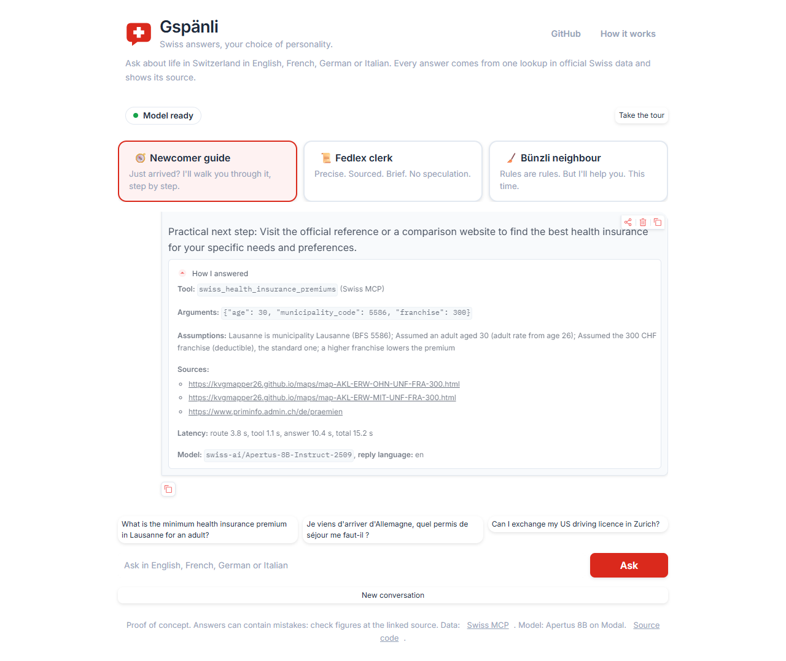
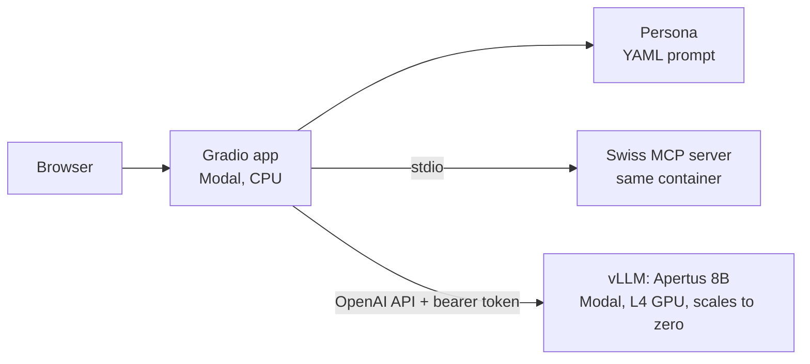

# Gspänli

**Swiss answers, your choice of personality.**

Ask in your language, grounded in official sources in theirs.

**[Try the live demo](https://vvanloo1--gspaenli-ui.us-east.modal.run)** · [Project page](https://vincvloo.github.io/gspaenli/)



Gspänli is a proof of concept: a chat about life in Switzerland where you pick a personality and every answer is grounded in one lookup in official Swiss data. Ask in English, French, German or Italian and you get the answer in your language, even when the source is in another one. Under each answer, **How I answered** shows the tool, its arguments, the assumptions and the source.

Gspänli is Swiss German for buddy.

## What you can ask

| Personality | Voice | Good at |
|---|---|---|
| Newcomer guide | warm, step by step | residence permits, health insurance premiums, housing, driving licence exchange, school holidays |
| Fedlex clerk | dry, precise, always cites | federal political rights, parcel import VAT, company register, saved official pages |
| Bünzli neighbour | rule-loving, mildly passive-aggressive, helpful | rent reference rate, housing rules, waste collection, weather, school holidays |

Examples: *What is the minimum health insurance premium in Lausanne for an adult?* · *Quand sont les vacances scolaires d'automne dans le canton de Vaud ?* · *Chi può votare alle elezioni del Consiglio nazionale?*

## How it works



Each turn makes two model calls and one tool call:

1. **Route.** The model gets the question, the persona's preferred tools and the tool list, and returns strict JSON: `{"tool": ..., "arguments": ..., "lang": ...}`. vLLM enforces the JSON schema. If parsing fails, it retries once, then falls back to a full-text search.
2. **Resolve and call.** The app fixes what a small model cannot know. "Lausanne" or "Losanna" becomes municipality number 5586 (from the MCP's own places database), canton names become codes, and an age or franchise is only used if the user actually wrote it, otherwise a stated default applies. Then it calls one tool on the [Swiss MCP server](https://github.com/dantevier/swiss-ai-week-mcp).
3. **Answer.** The model answers in persona using only the tool result, in the language of the question. Source links in the panel come from the data, not from the model.

The model does not need native tool calling, so any OpenAI-compatible endpoint works.

## Why prompting, not finetuning

The goal was distinct personalities on top of reliable facts. A finetune would need hundreds of good in-character, multilingual, grounded answers per persona, and a GPU budget to train and evaluate them. We had neither, and a LoRA trained on a few dozen examples would mostly learn the style while hurting grounding and multilingual behaviour that Apertus already has. A system prompt gives the same voice control for free, can be changed in a YAML file in seconds, and keeps facts out of the weights where they would go stale. The real accuracy problems we hit (wrong language detection, invented ages, unknown municipality codes) were fixed in code, not in weights. Finetuning becomes worth it once there is a dataset of real conversations to learn from. [What a finetune would take](docs/FINETUNE.md) sketches the data, cost on Modal and evaluation for a small LoRA.

## Evals

12 questions in four languages, run through the real pipeline, with every answer checked by hand against the data it came from. Details and per-question grades: [evals/README.md](evals/README.md).

| Model | Right tool | Right language | Fully grounded | Median time |
|---|---|---|---|---|
| Apertus 8B | 12/12 | 12/12 | 10/12 | 10.4 s |
| Qwen3 8B | 12/12 | 12/12 | 11/12 | 11.6 s |

The first run looked good on tool choice alone (Apertus 11/12), but only about half of the answers were fully grounded: some came from the model's memory after a rejected tool call, invented coordinates or an invented date. Each problem became a small, tested fix in code: argument repair, treating non-answers as missing data, a relevance check on search results, and an honest "not in the official data" answer with nothing to improvise from.

## Run it yourself

Requirements: Python 3.11+, [uv](https://docs.astral.sh/uv/), a [Modal](https://modal.com) account.

```bash
git clone https://github.com/vincvloo/gspaenli && cd gspaenli
uv sync
sh scripts/fetch_mcp.sh          # Swiss MCP at v1.0 into vendor/
uv run pytest                    # unit tests, fake LLM and fake MCP
```

Deploy the model server and the app:

```bash
uv run modal setup
uv run python scripts/rotate_llm_key.py        # creates the LLM key in .env and in Modal
uv run modal deploy llm_server/serve.py        # prints the LLM URL, put it in .env as LLM_BASE_URL
uv run python scripts/create_app_secret.py     # app secret from .env, never prints the key
uv run modal deploy modal_app.py               # prints the public URL
```

Local UI against the deployed model: `uv run python -m gspaenli.ui`. Command line: `uv run gspaenli ask "Quelle est la prime minimale à Lausanne ?" --trace`.

### Switch the model

The model is a deploy parameter, no code change:

```bash
MODEL_ID=Qwen/Qwen3-8B uv run modal deploy llm_server/serve.py
```

Set the same `MODEL_ID` in `.env` and rerun `scripts/create_app_secret.py`. The app also works with any OpenAI-compatible endpoint: set `LLM_BASE_URL`, `LLM_API_KEY`, `MODEL_ID`, and `LLM_JSON_SCHEMA=false` if the endpoint does not support JSON schema output. `GPU` (default `L4,A10`, tried in order) is also a deploy parameter.

### Add a personality

Add a YAML file to `personas/` with `id`, `name`, `tagline`, `system_prompt`, `preferred_tools`, `example_questions` (3), `language_hint` and an optional `avatar` emoji. File names set the order.

## Cost

Both Modal apps scale to zero. The GPU (L4, about $0.80 per hour) runs only while answering and for 5 minutes after; the app container stays up 15 minutes after the last visit. Limits: one GPU container, 20 questions per session, 300 per day. The first answer after idle takes about 2 minutes while the model loads, later ones 5 to 12 seconds.

## Known limits

- One tool call per turn. Questions that need two lookups get a partial answer.
- Apertus 8B sometimes adds facts that are not in the data, especially when the lookup returns little (see [evals](evals/README.md)), or credits a source to the wrong office. The source links in the panel are always taken from the data.
- When the data does not cover a question (for example waste collection days in Bern), the app says so. A question in one language against saved pages in another can also end up as "not found".
- Persona flavour is uneven, especially for the Bünzli neighbour.
- Data is what the Swiss MCP covers: premiums are 2026 only, some topics only exist as saved pages.
- English, French, German and Italian are supported. Swiss German answers are not a goal.
- The UI keeps conversations in the browser tab only; nothing is stored.

## Next steps

- Multi-step tool use (lookup, then lookup again) for questions that need it.
- More eval questions, and an automatic grounding check instead of reading answers by hand.
- Voice: speech in and out in four languages.

## Project layout

```
gspaenli/         app: config, personas, MCP client, router, resolver, orchestrator, UI
personas/         one YAML file per personality
llm_server/       vLLM on Modal
modal_app.py      Gradio app on Modal
evals/            questions with expected tool and language
tests/            unit tests (fake LLM, fake MCP) and one integration test
docs/             plan and the GitHub Pages site
```

## Credits

- [Swiss MCP server](https://github.com/dantevier/swiss-ai-week-mcp) (MIT), built during Swiss AI Week by Roberto Cerrone, Edoardo Diana, Alberto Minetti, Vincent Van Loo, Victor Bonilla, Jesus Sebastian and Jiaqi Yu.
- [Apertus](https://huggingface.co/swiss-ai/Apertus-8B-Instruct-2509) by the Swiss AI Initiative (Apache 2.0).
- [Modal](https://modal.com), [vLLM](https://github.com/vllm-project/vllm), [Gradio](https://www.gradio.app), [driver.js](https://driverjs.com) (MIT).

MIT license.
